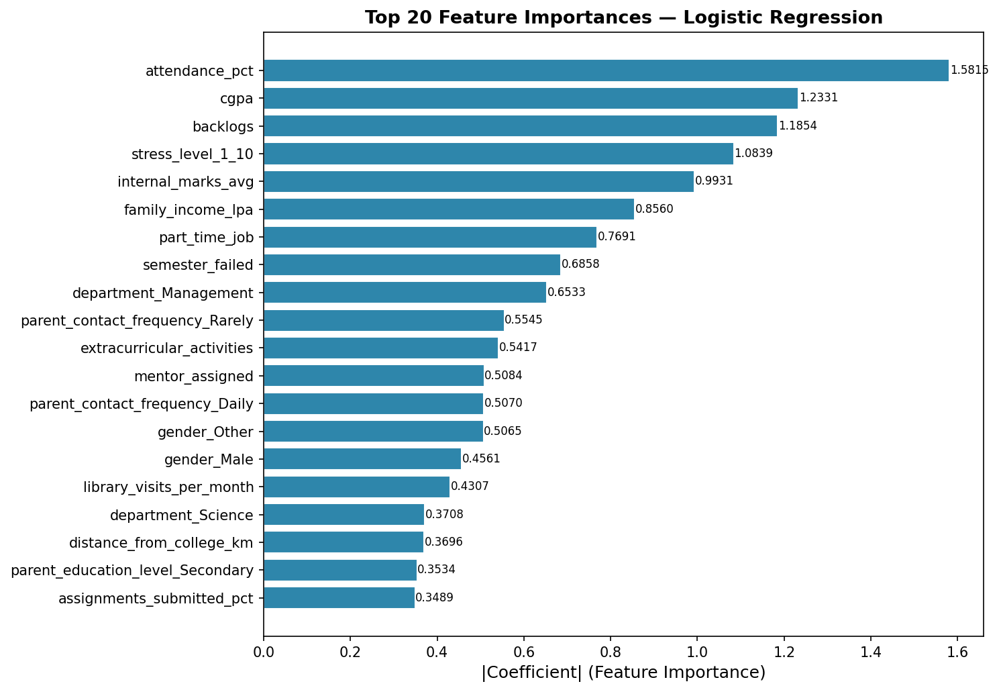

# Studvisor: Enterprise Academic ERP & Student Risk Analytics

A college enterprise resource planning platform combining a FastAPI backend, role-based access control, rule-based dropout-risk scoring and an academic chat assistant.


---

## Technical Overview

Higher education administrative systems typically suffer from fragmented databases, poor security audit trails, and reactive rather than proactive student support. Studvisor addresses these institutional bottlenecks by unifying administrative lifecycle management with rule-based early-warning risk scoring.

The platform executes three critical institutional functions:
1. Early Academic Intervention: Rule-based scoring (`backend/services/predictive_service.py`) combines attendance trend, assignment submission rate, unpaid fees and overall attendance into a weighted dropout-risk score from 0 to 1, and lists the signals each student triggers.
2. Academic Chat Assistant: The web app's chat uses a built-in rule-based chatbot and streams its reply word by word over Server-Sent Events. Separate `/v2/ai` API endpoints add the user's database records to the prompt for Anthropic's Claude (model ID `claude-3-sonnet-20240229` in the code). Without `ANTHROPIC_API_KEY`, the non-streaming call tries a local Ollama model and then returns a mock reply; the streaming call returns a mock reply.
3. Attendance Amendments: The amend endpoint has a time limit and requires a reason. For older records, faculty can submit a request that a head of department (HOD) approves or rejects.

---

## Risk Scoring & Offline Model Comparison

The risk scoring service is designed to flag students who may need support. The charts below come from a separate offline classifier comparison. This repository includes the chart images, but not a script or data file that produces them.

### 1. Classifier Benchmarking & ROC Evaluation

An offline comparison of Random Forest, Gradient Boosting, HistGradient Boosting and Logistic Regression is shown below. Logistic Regression had the highest test AUC (0.958); the two gradient-boosting variants had the highest test accuracy (0.917 and 0.920). The production scoring service is rule-based; these classifiers are an offline benchmark.


The Receiver Operating Characteristic curves illustrate true positive versus false positive rates across decision thresholds. All four classifiers reach a test AUC above 0.93.


### 2. Feature Attribution & Risk Stratification

The feature chart shows absolute Logistic Regression coefficients from the offline comparison. The largest are attendance percentage, CGPA, backlogs, stress level and average internal marks. These are not the weights used by the rule-based scoring service.



The risk distribution chart shows risk categories and engagement risk scores for the offline dataset, with a threshold of 55. These are separate from the risk levels returned by the scoring service.


In the Logistic Regression confusion matrix, the classifier identified 62 of 75 at-risk cases (83% recall) and missed 13. Of the 87 cases it flagged, 62 were at risk (71% precision).


---

## System Architecture

```text
[ Frontend: React 19 + Vite ]
                     |
                     | (RESTful JSON / SSE Streaming / JWT Bearer)
                     v
       [ FastAPI Application Layer ]
                     |
      +--------------+--------------+
      |                             |
[ Security Gateway ]       [ Business Domain Services ]
      |                             |
      +---> JWT Verification        +---> Risk Scoring Engine (Dropout / Failure)
      +---> Role-Based Access       +---> Timetable Generator & Conflict Detector
      +---> Audit Logger Middleware +---> Merit Points & Leaderboard
      |                             +---> HTML Marksheets & CSV Export
      v                             |
[ SQLite default / PostgreSQL ]     v
(PostgreSQL in Compose)     [ Anthropic / Ollama Adapter ]
                            (Database context in prompts)
```

---

## Security & Access Control

What the current code does:

1. Authentication: JSON Web Tokens signed with HS256. By default, access tokens last 120 minutes and refresh tokens 7 days. `/refresh` issues a new access token; refresh tokens are not rotated.
2. Role Checks: FastAPI dependencies and a route-prefix middleware check the role in the token. Roles are student, faculty, HOD, admin and parent.
3. Attendance Amendments: The amend endpoint closes 24 hours after 17:00 on the class date (compared in UTC). Later changes can go through a single HOD approval. The attendance marking endpoint can also overwrite existing records and has no time limit.
4. Audit Logging: Middleware writes a server log line with the method, path, response status, actor and IP address for POST, PUT, PATCH and DELETE requests, except some chat routes. Saving these entries to the database does not currently work.
5. Campus Wall: Anonymous posts are stored with a truncated HMAC-SHA256 of the student ID, using a salt that changes daily, instead of the ID itself. The server log described above still records who sent each request.

---

## Data Model Specifications

The persistence layer defines 44 SQLAlchemy models. Alembic is set up, but the repository contains no migration files. Selected models:

| Entity Category | Selected Models | Operational Responsibility |
|---|---|---|
| People | Student, Faculty, Admin, Parent | Records for each type of user |
| Academic Structure | Subject, SyllabusTopic, CourseEnrollment, TimetableSlot, AcademicCalendar | Subjects, syllabus topics, enrollment and scheduling |
| Performance | Attendance, Mark, GPARecord, ExamSchedule, Assignment, AssignmentSubmission | Attendance, marks, GPA, exams and coursework |
| Risk Scoring | AIRiskScore | Schema for stored risk scores and signals; defined, but not yet used by the scoring service |
| AI Chat | ChatHistory | Chat queries, responses, page context and session IDs |

---

## Repository Structure

```text
Studvisor/
├── backend/
│   ├── main.py                # FastAPI app, middleware and CORS setup
│   ├── api/
│   │   └── routes/
│   │       ├── admin.py          # Dashboard, users, leave and reports
│   │       ├── faculty_portal.py # Attendance, marks, leave and assignments
│   │       ├── student.py        # Profile and mood check-in
│   │       ├── ai_engine.py      # AI chat and related AI endpoints
│   │       ├── reports.py        # HTML marksheets, certificates and fee receipts
│   │       └── ...               # Other route modules
│   ├── core/
│   │   ├── config.py          # Environment settings
│   │   ├── security.py        # Password hashing, tokens and role checks
│   │   └── ai_context.py      # Role-specific database context for AI prompts
│   ├── middleware/
│   │   ├── audit_log.py       # Logging of write requests
│   │   └── role_guard.py      # Role checks by route prefix
│   ├── services/
│   │   ├── predictive_service.py  # Rule-based risk scoring
│   │   ├── merit_service.py       # Merit points, tiers and leaderboard
│   │   ├── timetable_service.py   # Timetable conflict detection
│   │   └── ...                    # Other services
│   └── app/
│       ├── database.py        # Database engine and sessions
│       ├── middleware.py      # Request logging and security headers
│       ├── models.py          # SQLAlchemy models
│       └── schemas.py         # Pydantic data validation models
├── frontend/                # React and Vite interface
├── docs/plots/              # Offline model evaluation charts
├── tests/                   # Pytest API tests
├── alembic/                 # Alembic setup (no migration files yet)
├── docker-compose.yml       # Multi-container setup
└── Dockerfile               # Container build definition
```

---

## Local Development & Setup

### 1. Repository Setup
```bash
git clone https://github.com/harctik/Studvisor.git
cd Studvisor
python -m venv venv

# Windows:
venv\Scripts\activate
# Linux/macOS:
source venv/bin/activate

pip install -r requirements.txt
```

### 2. Configuration & Database Initialization

`SECRET_KEY` is required. It signs login tokens, so use a private random value and keep it out of Git. Generate one with the command below, then add it as `SECRET_KEY=your-value` to a `.env` file in the repository root. The app and Docker Compose both read it from there.

```bash
python -c "import secrets; print(secrets.token_urlsafe(48))"
```

The default database is a local SQLite file. To change other settings, set environment variables such as `DATABASE_URL`, `ANTHROPIC_API_KEY`, `OLLAMA_URL` and `OLLAMA_MODEL` in your shell. The repository has no `.env.example` file.

```bash
python -m backend.seed_all
```

### 3. Launching the Backend Service
```bash
uvicorn backend.main:app --reload --port 8000
```

### 4. Executing the Test Suite
```bash
pytest tests/ -v
```

### 5. Multi-Container Orchestration
```bash
docker-compose up --build -d
```

---

## Author and Engineering Attribution

All architecture, backend API design, database schemas, risk scoring, and AI integration in this repository were engineered end-to-end by Avvari Naga Harthikanand (Harthik).

Developer: Avvari Naga Harthikanand
Location: Bangalore, Karnataka, India
LinkedIn: https://www.linkedin.com/in/harthik
GitHub: https://github.com/harctik
Email: harthikanand90@gmail.com
License: MIT License
