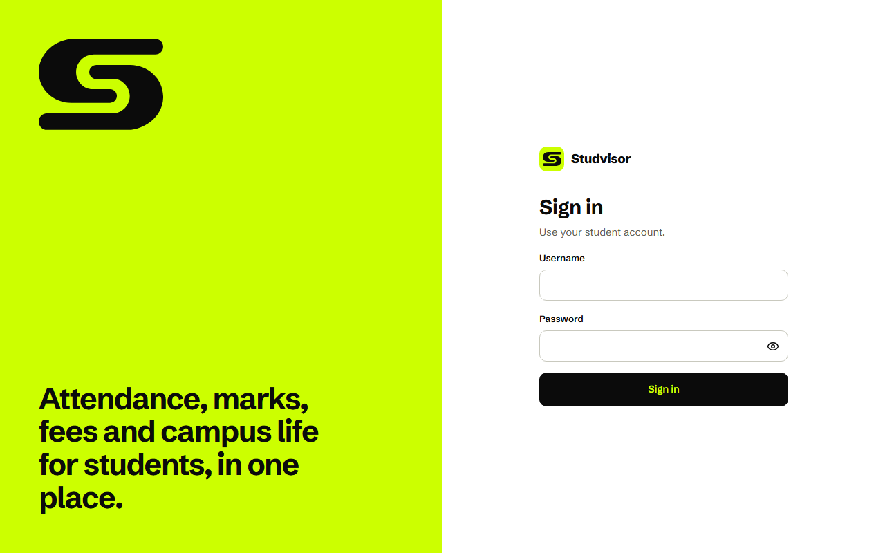
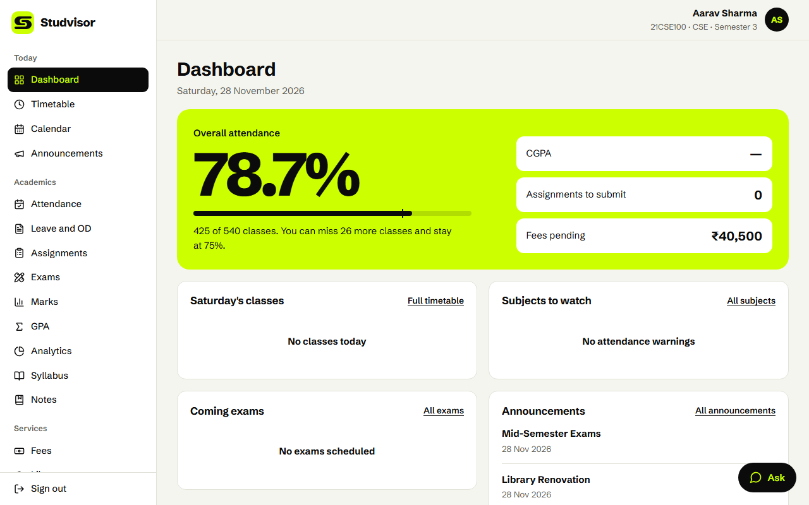
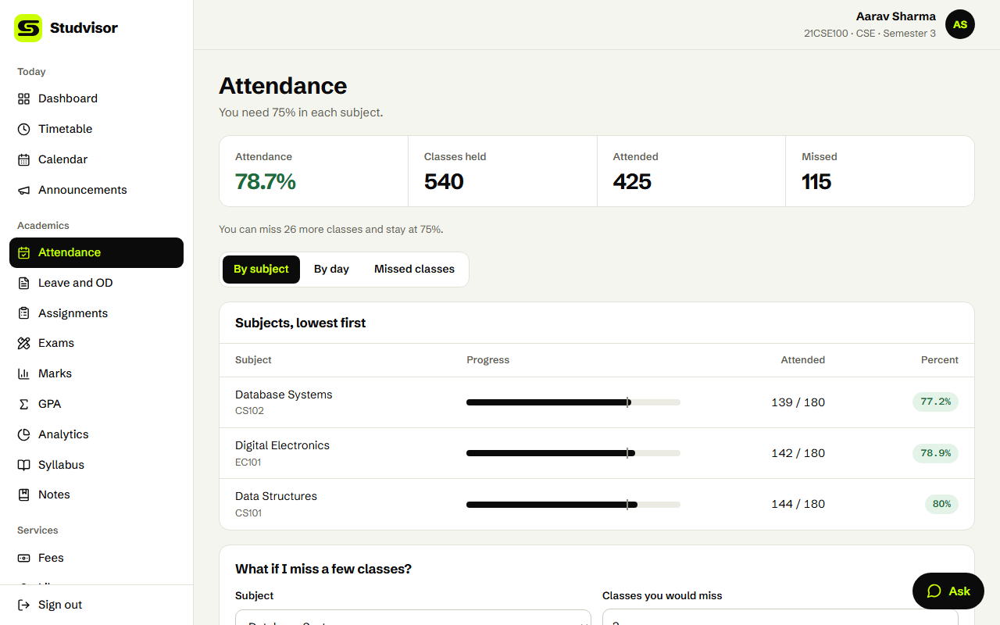
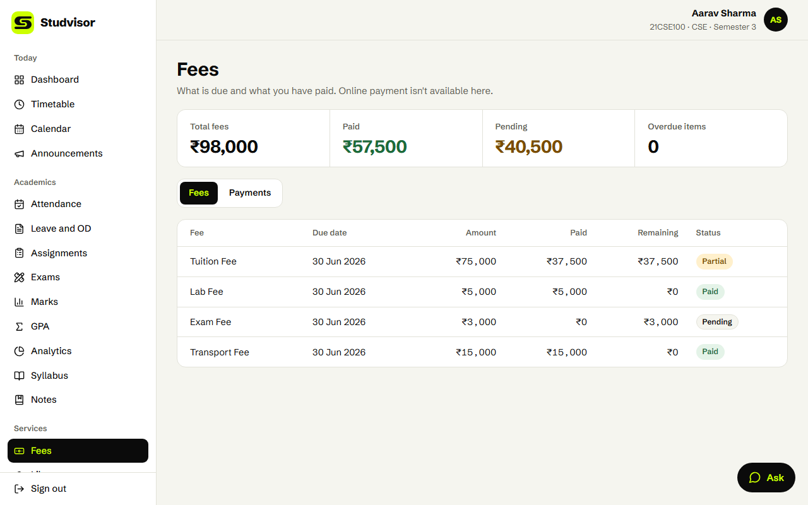
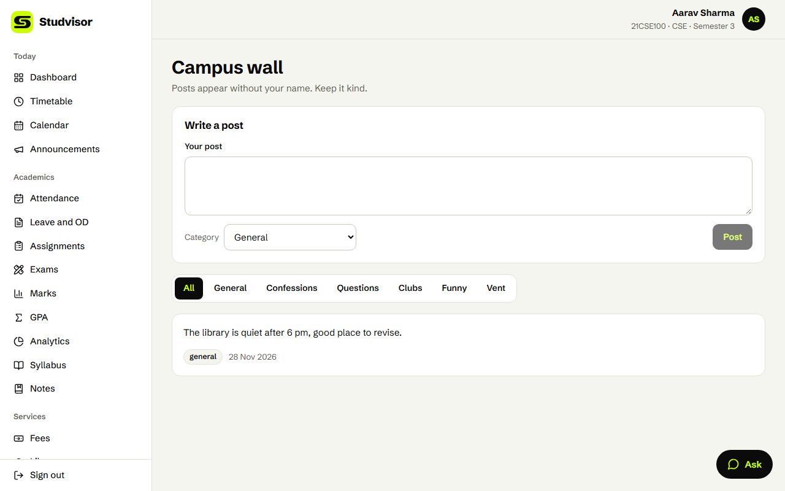

# Studvisor

Studvisor is a college management app. It has a FastAPI backend with APIs for students, faculty and admins, and a React web app for students.

The web app covers attendance, timetable, exams, results, GPA, assignments, leave, fees, notes, library, placement, complaints, events, polls, a leaderboard and an anonymous campus wall. Faculty and admin features are available through the API only.

## Screenshots

These show the local app with seeded sample data.











## How some features work

**Risk scoring.** `backend/services/predictive_service.py` uses fixed rules, not a trained model. The dropout-risk score runs from 0 to 1 and looks at the change in attendance, assignment submissions, unpaid fees and overall attendance. It also lists the signals behind the score.

**Chat.** The web chat uses a rule-based chatbot. The separate `/v2/ai` endpoints can add database records to a prompt and send it to Anthropic's API when `ANTHROPIC_API_KEY` is set. The model ID is fixed in `backend/services/ai_service.py` (`claude-3-sonnet-20240229`), and I have not checked that the API still accepts it. Without a key, or if the request fails, the non-streaming call tries a local Ollama server and then returns a placeholder reply. The streaming call returns a placeholder reply when there is no key.

**Fees.** There is no payment gateway. `POST /fees/pay` only records a payment claim as pending. The fee balance changes when an admin approves the claim through `/fees/admin/claims/{id}/approve`. Admins can also reject it. The web app shows fees but has no screen for sending or reviewing claims.

**Attendance changes.** The amend endpoint requires a reason and closes 24 hours after 17:00 on the class date, compared in UTC. After that, faculty can send a request for a head of department to approve or reject. The attendance marking endpoint can still overwrite a record at any time.

## Access control

- Login tokens are JWTs signed with HS256. By default, access tokens last 120 minutes and refresh tokens 7 days. Refresh tokens are not replaced when used.
- Protected routes check the role in the token. The roles in the code are student, faculty, HOD, admin and parent.
- The campus wall, notes, search, leaderboard, faculty directory and chat stream require sign-in.
- The WebSocket at `/ws/{uid}` expects `{"type": "auth", "token": "..."}` as its first message. The token must be a student access token for that ID.
- POST, PUT, PATCH and DELETE requests are written to an audit log in the database, apart from some chat routes. Entries for anonymous wall routes leave out the sender and IP address.
- Wall posts are not returned with an author. The database stores a shortened HMAC of the student ID, keyed with a salt that changes daily, instead of the ID. The web server's own access log can still record IP addresses, so this does not hide a poster from whoever runs the server.

Known gaps, to deal with before using this with real students:

- Anyone who can reach the API can register a student account.
- Calendar, exams, announcements, events, polls, lost and found, library catalog, placement drives, clubs, transport routes and scholarships can be read without signing in.
- The faculty plagiarism check and exam readiness AI endpoints do not check that the faculty member teaches the subject.
- A default rate limit is configured in `backend/main.py`, but the middleware that applies it is not added. Do not rely on rate limiting.

## Project layout

```text
backend/
  main.py         FastAPI app, middleware and error handling
  api/routes/     HTTP and WebSocket routes
  app/            database models (45 tables), schemas and the rule-based chatbot
  core/           settings, tokens, role checks and the local test sign-in
  middleware/     audit log and role checks by route prefix
  services/       risk scoring, AI adapter, timetable checks and other logic
frontend/         React 19 and Vite web app
tests/            pytest tests
alembic/          Alembic setup, with no migration files yet
```

The app creates missing tables when it starts. It does not alter existing tables.

## Run it locally

You need Python and Node.js. CI uses Python 3.13, and the Docker build of the web app uses Node 20.

```bash
git clone https://github.com/harctik/Studvisor.git
cd Studvisor
python -m venv venv

# Windows
venv\Scripts\activate
# Linux or macOS
source venv/bin/activate

pip install -r requirements.txt
```

`SECRET_KEY` is required. It signs login tokens, so use a private random value and keep it out of Git. Generate one:

```bash
python -c "import secrets; print(secrets.token_urlsafe(48))"
```

Add it to a `.env` file in the repository root as `SECRET_KEY=your-value`.

The default database is a local SQLite file. Before seeding, set `SEED_ADMIN_PASSWORD`, `SEED_FACULTY_PASSWORD` and `SEED_STUDENT_PASSWORD` in your shell. If you skip this, the script uses fixed defaults that anyone can read in the source. The seed script is meant for an empty database.

```bash
python -m backend.seed_all
uvicorn backend.main:app --reload --port 8000
```

In a second terminal, start the web app:

```bash
cd frontend
npm install
npm run dev
```

Open `http://localhost:5173`. The web app calls the API at `http://127.0.0.1:8000` unless `VITE_API_BASE_URL` says otherwise.

Settings such as `DATABASE_URL` and `DEMO_LOGIN` can go in `.env`. Set `CORS_ORIGINS`, `ANTHROPIC_API_KEY`, `OLLAMA_URL`, `OLLAMA_MODEL` and the seed passwords in your shell, because the code reads them directly from the environment.

### Test sign-in (local only)

There is a shortcut for testing on your own computer. Add `DEMO_LOGIN=true` to `.env`, seed the database and start the API. The username and password for the shortcut are defined in `backend/core/demo_login.py`. It opens the demo student's account, because the web screens are for students only.

It is off by default. It only accepts requests from the same computer that carry no proxy headers, and it stays off on the hosting services the code checks for. Leave it unset anywhere other people can reach.

## Tests and lint

```bash
pytest tests/ -v
ruff check backend/
```

Ruff is not listed in `requirements.txt`, so install it with `pip install ruff`. Its settings are in `pyproject.toml`. The CI workflow in `.github/workflows/ci.yml` runs lint and tests, then builds the backend Docker image and checks `/health`.

## Docker Compose

`docker-compose.yml` defines PostgreSQL, the API and the web app. It reads `SECRET_KEY` from `.env`.

```bash
docker compose up --build
```

Use it for local development only. It has a fixed database password, publishes the database port, runs the API with auto-reload and runs the seed script each time the API container starts.

## Author

Built by Avvari Naga Harthikanand (Harthik), Bangalore, Karnataka, India.

- Repository: https://github.com/harctik/Studvisor.git
- LinkedIn: https://www.linkedin.com/in/harthik
- GitHub: https://github.com/harctik
- Email: harthikanand90@gmail.com
