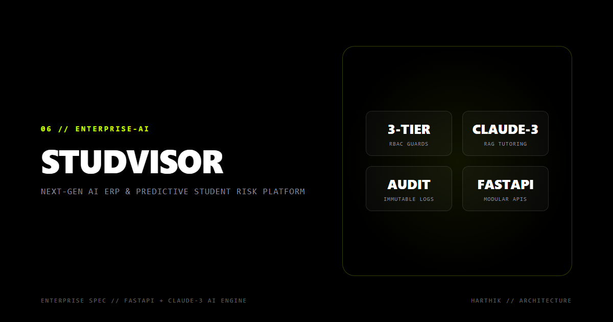

<div align="center">



<br/><br/>


# Studvisor: Enterprise Academic ERP & Predictive Student Analytics

A production-grade college enterprise resource planning (ERP) platform combining high-throughput FastAPI services, three-tier role-based access control (RBAC), and Anthropic Claude-3 for automated student dropout risk prediction and contextual academic tutoring.

[Architecture](#backend-architecture) | [Security & RBAC](#security--integrity-layer) | [AI Engine](#ai-engine-and-predictive-analytics) | [Project Structure](#project-structure) | [Deployment](#deployment) | [Attribution](#engineering-attribution)

</div>

---

## Technical Overview

Higher education administrative systems typically suffer from fragmented databases, poor security audit trails, and reactive rather than predictive student support. Studvisor addresses these institutional bottlenecks by unifying administrative lifecycle management with predictive machine learning algorithms.

The platform provides:
1. **Predictive Academic Intervention:** Evaluates attendance trajectories, grade volatility, and engagement indicators to compute probabilistic dropout risk scores before mid-term exams.
2. **Context-Aware LLM Tutoring:** Interfaces Anthropic Claude-3 through streaming Server-Sent Events (SSE) with access to curated institutional syllabus documents and personal performance metrics.
3. **Hardened Administrative Workflows:** Enforces time-bound attendance modifications with multi-signature head-of-department approval chains and tamper-evident audit logs.

---

## Backend Architecture

```
[ Frontend: React 18 + Vite + TailwindCSS ]
                     |
                     | (RESTful JSON / SSE Streaming / JWT Bearer)
                     v
       [ FastAPI Application Layer ]
                     |
      +--------------+--------------+
      |                             |
[ Security Gateway ]       [ Business Domain Services ]
      |                             |
      +---> JWT Verification        +---> Predictive Risk Engine (Dropout / Failure)
      +---> Three-Tier RBAC         +---> Timetable Constraint Solver (No Overlaps)
      +---> Audit Logger Middleware +---> Gamified Merit & Engagement Tracker
      |                             +---> Report Generator (PDF / HTML Marksheets)
      v                             |
[ PostgreSQL Persistence ]          v
(SQLAlchemy 2.0 + Alembic)  [ Anthropic Claude-3 Integration ]
                            (Context-Aware Academic RAG)
```

---

## Security & Integrity Layer

- **Three-Layer RBAC Architecture:** Security policies are enforced hierarchically:
  1. Cryptographic JWT signature and expiration verification.
  2. Route-level endpoint dependency guards restricting access by user role (`Admin`, `Faculty`, `Student`).
  3. Database-level tenant and cohort scoping preventing lateral data leaks.
- **Audit Middleware:** All state-modifying requests (`POST`, `PUT`, `DELETE`, `PATCH`) are logged with actor identity, timestamp, originating IP, and affected entity identifiers.
- **Attendance Integrity:** Implements a strict 24-hour edit window. Retrospective modifications require formal digital sign-off from designated academic supervisors.
- **Rotating HMAC Anonymity:** Campus forum interactions utilize daily rotating salts to prevent correlation analysis and identity de-anonymization.

---

## AI Engine and Predictive Analytics

### 1. Predictive Risk Engine
Nightly batch jobs evaluate multi-dimensional student performance metrics to identify at-risk cohorts:
- Attendance slope and decay velocity.
- Continuous internal assessment variances.
- Assignment submission delay indicators.

### 2. Context-Aware LLM Tutoring
The platform integrates Anthropic Claude-3 via streaming APIs:
- Synthesizes personalized academic roadmaps based on historical performance gaps.
- Automates exam paper generation aligned with syllabus coverage and Bloom's Taxonomy.
- Routes student grievances automatically based on sentiment severity scores.

---

## Project Structure

```text
Studvisor/
├── backend/
│   ├── api/
│   │   ├── routes/          # RBAC-guarded endpoint controllers
│   │   │   ├── admin.py     # Institutional analytics and user management
│   │   │   ├── faculty.py   # Grade records, attendance rosters, and class metrics
│   │   │   ├── student.py   # Profiles, engagement checks, and study plans
│   │   │   ├── ai_engine.py # Claude-3 orchestration and streaming endpoints
│   │   │   └── reports.py   # Academic report and marksheet generation
│   │   └── deps.py          # Auth dependencies and database session injection
│   ├── core/
│   │   ├── security.py      # Token signing, password hashing, and role scopes
│   │   ├── middleware.py    # Request audit logging and CORS configuration
│   │   └── ai_context.py    # RAG document retrieval for LLM context
│   ├── services/
│   │   ├── predictive.py    # At-risk scoring algorithms
│   │   ├── merit.py         # Gamified progression system
│   │   └── timetable.py     # Automated scheduling constraint solver
│   └── app/
│       ├── models.py        # 45+ SQLAlchemy relational schemas
│       └── schemas.py       # Pydantic data validation models
├── frontend/                # React / Vite / Tailwind UI application
├── tests/                   # Automated pytest unit and integration suites
├── alembic/                 # Database schema migration versions
├── docker-compose.yml       # Production multi-container specification
└── Dockerfile
```

---

## Deployment

### Prerequisites
- Python 3.10+
- PostgreSQL 14+
- Docker & Docker Compose (optional for containerized deployment)

### Local Development Setup

```bash
# 1. Clone the repository
git clone https://github.com/harctik/Studvisor.git
cd Studvisor

# 2. Virtual Environment Setup
python -m venv venv
# Windows:
venv\Scripts\activate
# Linux/macOS:
source venv/bin/activate

pip install -r requirements.txt

# 3. Environment Configuration
cp .env.example .env

# 4. Seed Database
python -m backend.seed_all

# 5. Start Server
uvicorn backend.main:app --reload --port 8000
```

### Containerized Deployment

```bash
docker-compose up --build -d
```

---

## Verification & Testing

The platform includes test suites verifying authentication scopes, route authorization guards, and database migrations:

```bash
pytest tests/ -v
```

GitHub Actions executes automated linting with **Ruff** and comprehensive test passes on every push.

---

## Engineering Attribution

All architecture, backend API design, database schemas, and AI integration in this repository were engineered by **Avvari Naga Harthikanand (Harthik)**.

- **Developer:** Avvari Naga Harthikanand
- **LinkedIn:** https://www.linkedin.com/in/harthik
- **GitHub:** https://github.com/harctik
- **Email:** harthikanand90@gmail.com
- **License:** MIT License
