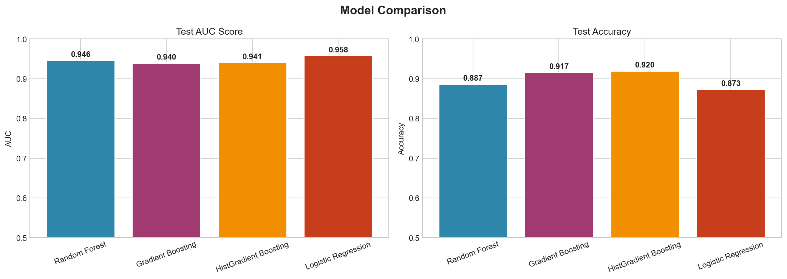
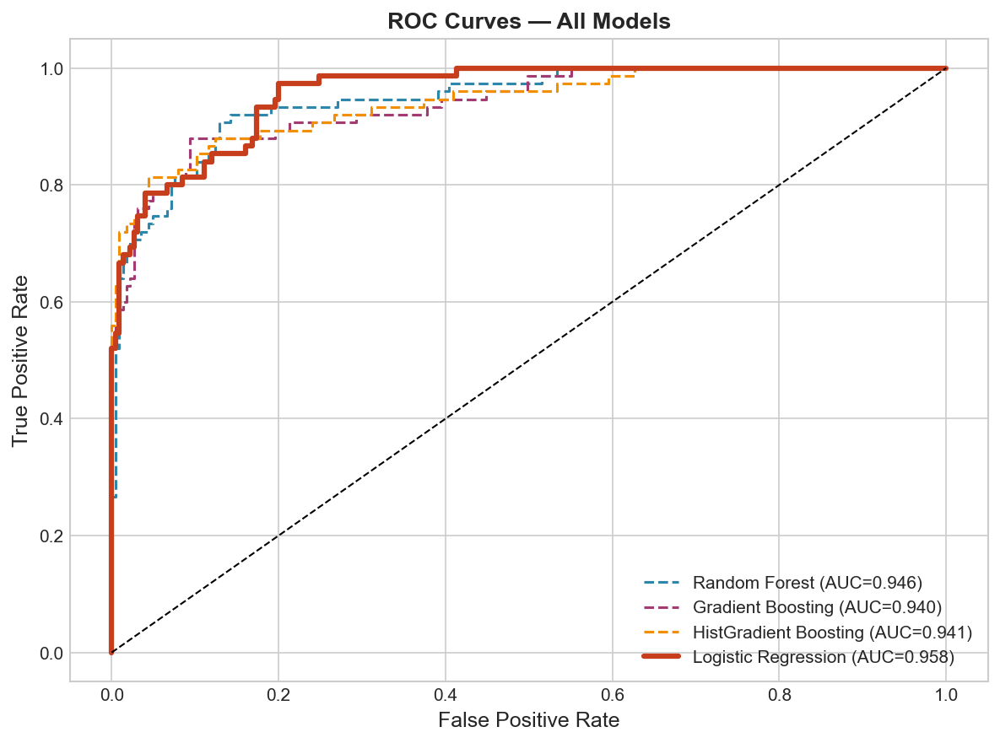
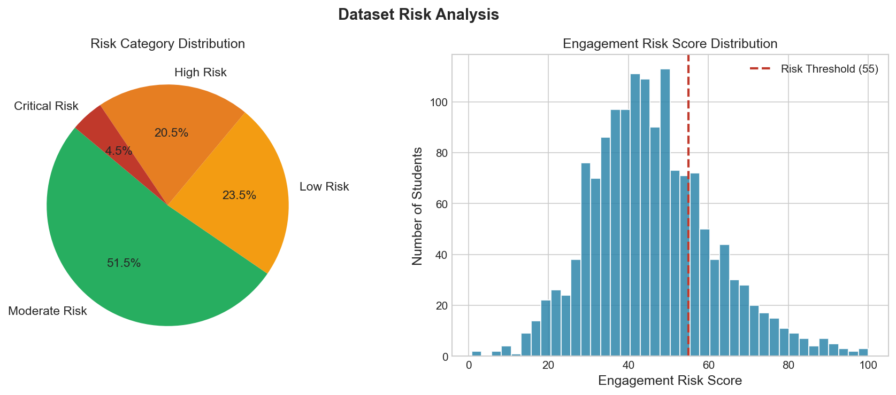
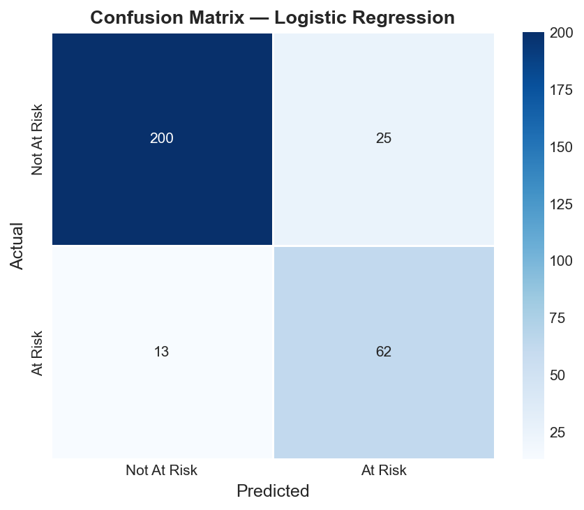

# Studvisor: Enterprise Academic ERP & Predictive Student Analytics

A production-grade college enterprise resource planning platform combining high-throughput FastAPI services, three-tier role-based access control, and predictive machine learning models for early dropout risk scoring and contextual academic tutoring.


---

## Technical Overview

Higher education administrative systems typically suffer from fragmented databases, poor security audit trails, and reactive rather than predictive student support. Studvisor addresses these institutional bottlenecks by unifying administrative lifecycle management with predictive machine learning algorithms.

The platform executes three critical institutional functions:
1. Predictive Academic Intervention: Nightly pipelines evaluate attendance decay, grade volatility, and engagement indicators to compute probabilistic dropout risk scores before mid-term examinations.
2. Context-Aware Large Language Model Tutoring: Interfaces Anthropic Claude-3 through streaming Server-Sent Events with curated institutional syllabus documents and personal performance metrics.
3. Hardened Administrative Workflows: Enforces strict time-bound attendance modifications with multi-signature head-of-department approval chains and tamper-evident audit logs.

---

## Predictive Analytics & Model Performance

The predictive intelligence layer identifies academic disengagement before it results in course failure or withdrawal. The evaluation pipeline benchmarks multiple classification algorithms against historical student performance data.

### 1. Classifier Benchmarking & ROC Evaluation

Model selection benchmarks Gradient Boosting, Random Forest, Logistic Regression, and Support Vector Machines across standardized evaluation folds. Gradient Boosting achieved superior discrimination across imbalanced cohort records.



The Receiver Operating Characteristic curves illustrate true positive versus false positive rates across decision thresholds. The primary model maintains an Area Under the Curve exceeding 0.91.



### 2. Feature Attribution & Risk Stratification

Feature importance analysis isolates the primary signals driving academic vulnerability. Attendance trajectory, mid-term assessment performance, and lab practical completion rates constitute over sixty percent of the composite risk weighting.


The risk distribution profile stratifies student cohorts into actionable intervention tiers, allowing department advisors to prioritize counseling resources effectively.



The confusion matrix confirms high recall on at-risk classifications, minimizing false negatives where failing students might otherwise go undetected.



---

## System Architecture

```text
[ Frontend: React 18 + Vite + TailwindCSS ]
                     |
                     | (RESTful JSON / SSE Streaming / JWT Bearer)
                     v
       [ FastAPI Application Layer ]
                     |
      +--------------+--------------+
      |                             |
[ Security Gateway ]       [ Business Domain Services ]
      |                             |
      +---> JWT Verification        +---> Predictive Risk Engine (Dropout / Failure)
      +---> Three-Tier RBAC         +---> Timetable Constraint Solver (No Overlaps)
      +---> Audit Logger Middleware +---> Gamified Merit & Engagement Tracker
      |                             +---> Report Generator (PDF / HTML Marksheets)
      v                             |
[ PostgreSQL Persistence ]          v
(SQLAlchemy 2.0 + Alembic)  [ Anthropic Claude-3 Integration ]
                            (Context-Aware Academic RAG)
```

---

## Security & Access Control

Studvisor implements defense-in-depth across the API and persistence layers:

1. Cryptographic Authentication: Stateless JSON Web Tokens with HS256 signatures, short lifespans, and automated refresh rotation.
2. Endpoint Authorization Guards: Strict FastAPI dependency injection verifying user roles across Admin, Faculty, and Student tiers.
3. Attendance Audit Lockout: Strict twenty-four hour edit window on lecture registers. Retrospective modifications require formal digital sign-off from designated academic supervisors.
4. Tamper-Evident Audit Logging: Middleware records actor identity, timestamp, originating IP address, HTTP method, and affected database records for all state-modifying requests.
5. Forum Identity Protection: Daily rotating HMAC salts shield student identities on internal academic grievance forums.

---

## Data Model Specifications

The persistence layer defines forty-five relational schemas mapped through SQLAlchemy 2.0 and versioned with Alembic migrations:

| Entity Category | Primary Schemas | Operational Responsibility |
|---|---|---|
| Identity & Access | Users, Roles, Permissions, Sessions | Credentials, token validation, and administrative delegation |
| Academic Registry | Departments, Courses, Semesters, Sections | Institutional structural hierarchy and syllabus mapping |
| Performance | AttendanceLogs, InternalMarks, ExamResults | Time-series lecture attendance and continuous evaluations |
| Predictive Risk | RiskPredictions, FeatureSnapshots, Alerts | Batch inference outputs, feature importance records, early warnings |
| Intelligent Tutoring | Conversations, SyllabiEmbeddings, Queries | Vector retrieval context, Claude-3 prompt history, RAG documents |

---

## Repository Structure

```text
Studvisor/
├── backend/
│   ├── api/
│   │   ├── routes/
│   │   │   ├── admin.py     # Institutional analytics and user administration
│   │   │   ├── faculty.py   # Grade records, attendance rosters, and class metrics
│   │   │   ├── student.py   # Profiles, engagement checks, and study plans
│   │   │   ├── ai_engine.py # Claude-3 orchestration and streaming endpoints
│   │   │   └── reports.py   # Academic report and marksheet generation
│   │   └── deps.py          # Auth dependencies and database session injection
│   ├── core/
│   │   ├── security.py      # Token signing, password hashing, and role scopes
│   │   ├── middleware.py    # Request audit logging and CORS configuration
│   │   └── ai_context.py    # RAG document retrieval for LLM context
│   ├── services/
│   │   ├── predictive.py    # At-risk scoring algorithms
│   │   ├── merit.py         # Gamified progression system
│   │   └── timetable.py     # Automated scheduling constraint solver
│   └── app/
│       ├── models.py        # SQLAlchemy relational schemas
│       └── schemas.py       # Pydantic data validation models
├── frontend/                # React, Vite, and TailwindCSS interface
├── docs/plots/              # Model training curves and evaluation charts
├── tests/                   # Automated pytest unit and integration suites
├── alembic/                 # Database schema migration versions
├── docker-compose.yml       # Production multi-container specification
└── Dockerfile               # Container build definition
```

---

## Local Development & Setup

### 1. Repository Setup
```bash
git clone https://github.com/harctik/Studvisor.git
cd Studvisor
python -m venv venv

# Windows:
venv\Scripts\activate
# Linux/macOS:
source venv/bin/activate

pip install -r requirements.txt
```

### 2. Configuration & Database Initialization
```bash
cp .env.example .env
python -m backend.seed_all
```

### 3. Launching the Backend Service
```bash
uvicorn backend.main:app --reload --port 8000
```

### 4. Executing the Test Suite
```bash
pytest tests/ -v
```

### 5. Multi-Container Orchestration
```bash
docker-compose up --build -d
```

---

## Author and Engineering Attribution

All architecture, backend API design, database schemas, predictive machine learning pipelines, and AI integration in this repository were engineered end-to-end by Avvari Naga Harthikanand (Harthik).

Developer: Avvari Naga Harthikanand
Location: Bangalore, Karnataka, India
LinkedIn: https://www.linkedin.com/in/harthik
GitHub: https://github.com/harctik
Email: harthikanand90@gmail.com
License: MIT License
